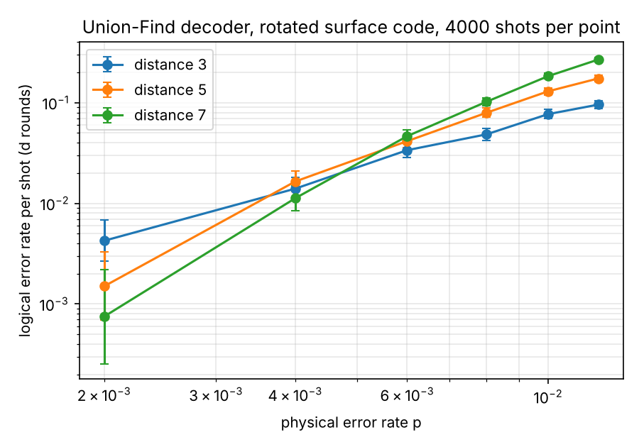

# QEC decoders from scratch

Eleven surface-code decoders (eight algorithms, one variant and two combinations) in plain
Python/NumPy, with tests that compute decoder metrics. Written during MidQWest 2026 (Nov 21-22) for the
Northrop Grumman decoder challenge. Syndromes come from Stim. PyMatching appears only as a
reference to check our matching decoder against; no decoder here calls it.

## Decoders

| Decoder | File | Idea | Where the parallelism is |
|---|---|---|---|
| MWPM, exact | `qecdec/mwpm.py` | Minimum-weight matching by dynamic programming over defect subsets, after splitting defects into provably independent groups | Groups are independent |
| Union-Find | `qecdec/unionfind.py` | Grow odd clusters until neutral, then peel a spanning forest (Delfosse and Nickerson) | Cluster growth is local |
| Belief propagation | `qecdec/bp.py` | Normalized min-sum on the error-mechanism graph, Union-Find fallback when it does not settle | Every message in an iteration updates at once; batched over shots here |
| Local matching | `qecdec/local_matching.py` | Round-synchronous matching: mutual nearest defects within a growing radius pair up | One round is one parallel step; 9 rounds at most in our runs |
| Greedy matching | `qecdec/greedy.py` | Commit the cheapest pairing first | Sort dominates; tiny state |
| Lookup table | `qecdec/lookup.py` | Enumerate fault combinations up to a weight, store the likeliest per syndrome | One table read per shot |
| Tsetlin machine | `qecdec/tsetlin.py` | Learned AND-rules over per-stabilizer time parities | Bitwise rule evaluation, batched |
| Clifford-clause machine | `qecdec/clifford_clause.py` | Same rule learner over cut parities derived from the decoding graph (or, as a variant, parities it discovers from syndromes alone) | Literals are XOR trees; rules are bitwise; batched |
| Cut vote + matching | `qecdec/cut_vote.py` | If all cut parities agree, answer at once; otherwise match | Fast path is XOR trees only |
| Clifford-clause + matching | `qecdec/hybrid.py` | Rule machine answers when its vote margin is large; exact matching takes the rest | Most shots never reach the graph search |

All share `qecdec/graph.py`, which turns a Stim detector error model into a weighted decoding
graph (each boundary fault gets its own boundary vertex) and precomputes shortest paths.
`qecdec/parallel.py` splits a batch of shots across processes.

## The Clifford-clause idea

On syndrome bits a CNOT circuit is a GF(2)-linear map, so a clause that ANDs outputs of a
Clifford circuit is an AND of parity checks: one rule covers a whole affine subspace of
syndromes, where a lookup table needs one entry per syndrome. The question is which parities.

Cut parities work. Give each detector a level, its hop distance from the boundary whose faults
flip the logical observable, and let cut_k be the XOR of all detectors with level <= k. A fault
on that boundary flips every cut. Any other single fault flips at most one (tested for every
fault in the distance-5 model). So each cut is a vote on the logical flip, and the cuts err on
different faults. XORing a cut with one nearby stabilizer's parity bulges the cut around that
stabilizer and gives another vote. cut_k is a prefix-XOR over levels: a CNOT ladder of
logarithmic depth.

## Results

Rotated surface code memory, circuit-level depolarizing noise, rounds = distance, 20,000 shots.
Logical error rate per shot.

| Decoder | d=3, p=0.002 | d=3, p=0.005 | d=5, p=0.002 | d=5, p=0.005 |
|---|---|---|---|---|
| MWPM (exact, subset DP) | 0.0029 | 0.0181 | 0.0010 | 0.0146 |
| Union-Find | 0.0040 | 0.0232 | 0.0022 | 0.0261 |
| Belief propagation + UF fallback | 0.0037 | 0.0217 | 0.0019 | 0.0249 |
| Local matching (parallel rounds) | 0.0034 | 0.0211 | 0.0070 | 0.0403 |
| Greedy matching | 0.0034 | 0.0211 | 0.0101 | 0.0561 |
| Lookup table | 0.0034 | 0.0218 | 0.0022 | 0.0261 |
| Tsetlin machine (parity literals) | 0.0108 | 0.0404 | 0.0588 | 0.1898 |
| Clifford-clause TM (learned literals) | 0.0168 | 0.0570 | 0.0898 | 0.2207 |
| Clifford-clause TM (cut literals) | 0.0050 | 0.0290 | 0.0080 | 0.0722 |
| Cut vote -> MWPM (exact, subset DP) | 0.0042 | 0.0250 | 0.0011 | 0.0175 |
| Clifford-clause -> MWPM (margin 13) | 0.0037 | 0.0186 | 0.0011 | 0.0175 |
| No decoding | 0.0441 | 0.1043 | 0.1063 | 0.2277 |
| PyMatching (reference) | 0.0029 | 0.0181 | 0.0010 | 0.0144 |

Clifford-clause machine in front of exact matching, as the vote margin required to trust the
rules is raised (`benchmarks/hybrid_tradeoff.py`; each pair is share of shots answered by the
rules, then logical error rate):

| Margin | d=5, p=0.002 | LER | d=7, p=0.002 | LER | d=5, p=0.005 | LER |
|---|---|---|---|---|---|---|
| 4 | 99.3% | 0.0065 | 97.3% | 0.0093 | 92.4% | 0.0472 |
| 8 | 97.1% | 0.0041 | 92.4% | 0.0033 | 80.2% | 0.0289 |
| 11 | 93.0% | 0.0021 | 88.2% | 0.0017 | 69.6% | 0.0204 |
| 13 | 90.5% | 0.0011 | 85.3% | 0.0011 | 64.0% | 0.0175 |
| 15 | 89.2% | 0.0010 | 82.7% | 0.0013 | 59.9% | 0.0162 |
| Matching alone | 0% | 0.0010 | 0% | 0.0010 | 0% | 0.0146 |
| Rules alone | 100% | 0.0080 | 100% | 0.0192 | 100% | 0.0722 |

- Our exact matching reproduces PyMatching's logical error rate at every point (identical at
  three of four; at d=5, p=0.005 it used the greedy fallback on 19 of 20,000 shots).
- Cut literals moved the rule machine from 0.0588 to 0.0080 at d=5, p=0.002 (about 7x) and from
  0.0108 to 0.0050 at d=3 (near Union-Find's 0.0040). Alone it is still about 4x behind
  Union-Find at distance 5, and at distance 7 it is worse than at distance 5 (0.0192 against
  0.0080), so alone it has no threshold and is not a scalable decoder. Richer literals of the
  same kind (cuts bulged around single detectors) did not change that.
- In front of matching it is useful, and that holds at distance 7. With margin 13 at p=0.002
  the rules answer 90% of shots at distance 5 and 85% at distance 7, with logical error rates of
  0.0011 and 0.0011 against 0.0010 and 0.0010 for matching alone. Only 18% and 0.7% of those
  shots have an empty syndrome. The distance-7 figures rest on 10,000 shots (10 and 11 logical
  errors), so "equal to matching" there is within wide error bars. At p=0.005 the rules take
  about 60% of shots for a 15% to 20% higher error rate.
- In this Python the rule machine takes 19 microseconds per shot at distance 7 and our matching 811;
  both are unoptimized, so read that as a direction only.
- Union-Find is within about 1.3x to 2x of matching. BP with Union-Find fallback is slightly
  better than Union-Find alone; BP settled without the fallback on 58% to 97% of shots.
- Local matching equals greedy at distance 3 and beats it at distance 5, in at most 9 rounds.
- The lookup table uses weight-2 faults at distance 3 (2,460 entries) and weight-1 faults at
  distance 5, with Union-Find as fallback (it is mostly Union-Find at distance 5).
- Shot-level parallelism: Union-Find at d=5, p=0.005 ran 2.0x faster on 2 processes with
  identical output. Within-shot parallelism in the table is a property of the algorithms; only
  BP and the rule decoders are implemented in batched form here.
- Decode times in `benchmarks/results.txt` are unoptimized Python and only meaningful relative
  to each other. One sample of 20,000 shots per point, 95% Wilson intervals in that file. The
  rule decoders were trained on 30,000 separate shots with one seed.

Union-Find at distances 3, 5 and 7, 4,000 shots per point. The curves cross between p = 0.004
and p = 0.006: below that larger codes do better, above it worse.

## Metrics and tests

`qecdec/metrics.py`: logical error rate with a 95% Wilson interval, time per shot, a threshold
scan over distances and error rates, and a table formatter.

`tests/test_decoders.py` (run `pytest -q`):
- an empty syndrome decodes to no flip;
- every single fault in the error model is decoded to its own logical effect, at distance 3 and 5;
- our matching agrees with PyMatching shot by shot (> 99.5%) and in logical error rate;
- every decoder beats no decoding by at least 3x, and exact matching is the best of the graph decoders;
- distance 5 beats distance 3 below threshold;
- a repetition-code check, learning checks for both rule decoders, BP and local matching beating
  no decoding, parallel decoding equal to serial, and a confidence-interval check.

## Run

    pip install -r requirements.txt
    pytest -q
    python benchmarks/run_benchmark.py 20000
    python benchmarks/threshold_plot.py 4000

## Not done yet

Weighted Union-Find growth, BP-reweighted matching, a true cellular-automaton decoder,
time-windowed cuts and a block-hierarchical rule decoder (the routes to making the Clifford-clause
machine scale alone), and any compiled or within-shot parallel implementation.

## Prior work

The idea of using stabilizer/GF(2) structure as Tsetlin-machine literals comes from a team
member's earlier project. All code in this repository was written during the event.
