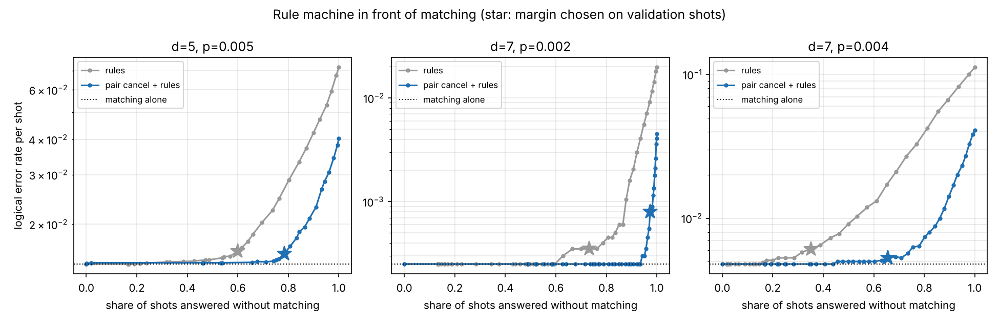

# QEC decoders from scratch

Eleven surface-code decoders (eight algorithms, one variant and two combinations) written from
scratch in Python/NumPy, with compiled (numba) kernels for matching and Union-Find, a
pair-cancellation predecoder, and tests that compute decoder metrics. Written during MidQWest 2026 (Nov 21-22) for the
Northrop Grumman decoder challenge. Syndromes come from Stim. PyMatching appears only as a
reference to check our matching decoder against; no decoder here calls it.

## Decoders

| Decoder | File | Idea | Where the parallelism is |
|---|---|---|---|
| MWPM, exact | `qecdec/mwpm.py` | Minimum-weight matching by dynamic programming over defect subsets, after splitting defects into provably independent groups | Groups are independent |
| Union-Find | `qecdec/unionfind.py` | Grow odd clusters until neutral, then peel a spanning forest (Delfosse and Nickerson) | Cluster growth is local |
| Belief propagation | `qecdec/bp.py` | Normalized min-sum on the error-mechanism graph, Union-Find fallback when it does not settle | Every message in an iteration updates at once; batched over shots here |
| Local matching | `qecdec/local_matching.py` | Round-synchronous matching: mutual nearest defects within a growing radius pair up | One round is one parallel step; 9 rounds at most in our runs |
| Greedy matching | `qecdec/greedy.py` | Commit the cheapest pairing first | Sort dominates; tiny state |
| Lookup table | `qecdec/lookup.py` | Enumerate fault combinations up to a weight, store the likeliest per syndrome | One table read per shot |
| Tsetlin machine | `qecdec/tsetlin.py` | Learned AND-rules over per-stabilizer time parities | Bitwise rule evaluation, batched |
| Clifford-clause machine | `qecdec/clifford_clause.py` | Same rule learner over cut parities derived from the decoding graph (or, as a variant, parities it discovers from syndromes alone) | Literals are XOR trees; rules are bitwise; batched |
| Cut vote + matching | `qecdec/cut_vote.py` | If all cut parities agree, answer at once; otherwise match | Fast path is XOR trees only |
| Clifford-clause + matching | `qecdec/hybrid.py` | Rule machine answers when its vote margin is large; exact matching takes the rest | Most shots never reach the graph search |
| Compiled matching and Union-Find | `qecdec/fast.py` | The same two algorithms as numba kernels; matching adds a window search for defect groups too large for the subset DP | Shots run on all cores (`prange`), no Python in the loop |
| Pair cancellation | `qecdec/predecode.py` | Predecoder: two neighbouring fired detectors that each have no other fired neighbour are one fault; clear them and record its logical effect | A fixed local rule per detector, one parallel step |

All share `qecdec/graph.py`, which turns a Stim detector error model into a weighted decoding
graph (each boundary fault gets its own boundary vertex) and precomputes shortest paths.
`qecdec/parallel.py` splits a batch of shots across processes.

## The Clifford-clause idea

On syndrome bits a CNOT circuit is a GF(2)-linear map, so a clause that ANDs outputs of a
Clifford circuit is an AND of parity checks: one rule covers a whole affine subspace of
syndromes, where a lookup table needs one entry per syndrome. The question is which parities.

Cut parities work. Give each detector a level, its hop distance from the boundary whose faults
flip the logical observable, and let cut_k be the XOR of all detectors with level <= k. A fault
on that boundary flips every cut. Any other single fault flips at most one (tested for every
fault in the distance-5 model). So each cut is a vote on the logical flip, and the cuts err on
different faults. XORing a cut with one nearby stabilizer's parity bulges the cut around that
stabilizer and gives another vote. cut_k is a prefix-XOR over levels: a CNOT ladder of
logarithmic depth.

## Results

Rotated surface code memory, circuit-level depolarizing noise, rounds = distance, 20,000 shots.
Logical error rate per shot.

| Decoder | d=3, p=0.002 | d=3, p=0.005 | d=5, p=0.002 | d=5, p=0.005 |
|---|---|---|---|---|
| MWPM (exact, subset DP) | 0.0029 | 0.0181 | 0.0010 | 0.0146 |
| Union-Find | 0.0040 | 0.0232 | 0.0022 | 0.0261 |
| Belief propagation + UF fallback | 0.0037 | 0.0217 | 0.0019 | 0.0249 |
| Local matching (parallel rounds) | 0.0034 | 0.0211 | 0.0070 | 0.0403 |
| Greedy matching | 0.0034 | 0.0211 | 0.0101 | 0.0561 |
| Lookup table | 0.0034 | 0.0218 | 0.0022 | 0.0261 |
| Tsetlin machine (parity literals) | 0.0108 | 0.0404 | 0.0588 | 0.1898 |
| Clifford-clause TM (learned literals) | 0.0168 | 0.0570 | 0.0898 | 0.2207 |
| Clifford-clause TM (cut literals) | 0.0050 | 0.0290 | 0.0080 | 0.0722 |
| Cut vote -> MWPM (exact, subset DP) | 0.0042 | 0.0250 | 0.0011 | 0.0175 |
| Clifford-clause -> MWPM (margin 13) | 0.0037 | 0.0186 | 0.0011 | 0.0175 |
| No decoding | 0.0441 | 0.1043 | 0.1063 | 0.2277 |
| PyMatching (reference) | 0.0029 | 0.0181 | 0.0010 | 0.0144 |

Rule machine in front of matching, with and without the pair-cancellation layer
(`benchmarks/hybrid_tradeoff.py`). Rules are trained on 30,000 shots, the vote margin is chosen
on 10,000 validation shots, and the figures below come from separate test shots (20,000 at
d=5 and at d=7, p=0.002; 10,000 otherwise). "Answered" is the share of shots that never reach
matching.

| Setting | Matching (PyMatching) | Rules: answered, LER | Pair cancel + rules: answered, LER | Rules alone, without and with the layer |
|---|---|---|---|---|
| d=5, p=0.002 | 0.00100 (0.00100) | 90.5%, 0.00110 | 96.6%, 0.00145 | 0.0081, 0.0046 |
| d=5, p=0.005 | 0.01445 (0.01440) | 59.9%, 0.01605 | 78.4%, 0.01570 | 0.0722, 0.0404 |
| d=7, p=0.002 | 0.00025 (0.00025) | 73.2%, 0.00035 | 97.4%, 0.00080 | 0.0198, 0.0045 |
| d=7, p=0.004 | 0.00480 (0.00410) | 35.2%, 0.00610 | 65.5%, 0.00530 | 0.1121, 0.0410 |
| d=9, p=0.002 | 0.00030 (0.00020) | 44.6%, 0.00040 | 95.9%, 0.00060 | 0.0443, 0.0049 |

Share of test shots answered by the rules at the largest coverage where the hybrid's error rate
is no worse than matching's on the same shots (margin read off the test curve, so optimistic):

| Setting | Rules | Pair cancel + rules |
|---|---|---|
| d=5, p=0.002 | 88% | 93% |
| d=7, p=0.002 | 60% | 93% |
| d=9, p=0.002 | 38% | 91% |
| d=7, p=0.004 | 15% | 44% |

- Our matching reproduces PyMatching's logical error rate where the window search rarely runs
  (d=5, and d=7 at p=0.002). At d=7, p=0.004 and d=9, p=0.002 it is behind (0.0048 against
  0.0041, 0.0003 against 0.0002): large defect groups go to the window search, which is a
  heuristic. An earlier version of this file compared against a matching decoder that fell back
  to greedy pairing at distance 7 and reported 0.0010 for it at p=0.002; the correct figure is
  0.00025, and the "rules equal matching at 85% coverage" claim made from it was wrong.
- Cut literals moved the rule machine from 0.0588 to 0.0080 at d=5, p=0.002 (about 7x) and from
  0.0108 to 0.0050 at d=3 (near Union-Find's 0.0040). Alone it gets worse with distance (0.0081,
  0.0198, 0.0443 at d=5, 7, 9), so alone it has no threshold.
- The pair-cancellation layer fixes most of that. It removes isolated single faults before the
  rules see the syndrome, and the rule machine alone then holds at about 0.0045 to 0.0049 across
  d=5, 7, 9 at p=0.002. That is flat, not falling, so it is still not a scalable decoder alone.
- In front of matching the layer raises coverage a lot. At p=0.002 the rules can answer about
  93%, 93% and 91% of shots at d=5, 7, 9 with the same error count as matching on those test
  shots, against 88%, 60% and 38% without the layer.
- The margin chosen on validation shots does not hit that point reliably. At d=7, p=0.002 it
  picked 97.4% coverage and the error rate was 0.00080 against 0.00025 for matching (16 errors
  against 5 in 20,000 shots). Matching makes so few errors here that 10,000 validation shots
  cannot place the margin; a deployment would need more validation data or a fixed conservative
  margin. All error rates at d=7 and d=9, p=0.002 rest on 5 to 16 logical errors.
- Speed, 2 threads: the compiled kernels give the same output as the Python reference and run
  45x to 55x faster for matching (400 to 8.9 and 785 to 14.2 microseconds per shot at d=5,
  p=0.005 and d=7, p=0.002) and 100x to 130x faster for Union-Find (351 to 3.5 and 936 to 7.1).
  The rule path with the layer costs 17, 53 and 115 microseconds per shot at d=5, 7, 9 in
  NumPy; compiled matching costs 1, 28 and 944 at p=0.002. So at d=9 the rule path is about 8x
  cheaper than the matching it replaces on 9 shots in 10; at d=5 and d=7 compiled matching is
  already faster than our NumPy rule path, and the case for the rules there is the hardware
  argument (fixed-depth XOR and AND logic), not this software timing.
- Union-Find is within about 1.3x to 2x of matching. BP with Union-Find fallback is slightly
  better than Union-Find alone; BP settled without the fallback on 58% to 97% of shots.
- Local matching equals greedy at distance 3 and beats it at distance 5, in at most 9 rounds.
- The lookup table uses weight-2 faults at distance 3 (2,460 entries) and weight-1 faults at
  distance 5, with Union-Find as fallback (it is mostly Union-Find at distance 5).
- Shot-level parallelism: Union-Find at d=5, p=0.005 ran 2.0x faster on 2 processes with
  identical output. The compiled kernels parallelize over shots with threads.
- The first results table (`benchmarks/results.txt`) uses the Python reference decoders, so its
  decode times are only meaningful relative to each other. One sample of 20,000 shots per
  point, 95% Wilson intervals in that file. The rule decoders were trained on 30,000 separate
  shots with one seed.

Union-Find at distances 3, 5 and 7, 4,000 shots per point. The curves cross between p = 0.004
and p = 0.006: below that larger codes do better, above it worse.

## Metrics and tests

`qecdec/metrics.py`: logical error rate with a 95% Wilson interval, time per shot, a threshold
scan over distances and error rates, and a table formatter.

`tests/test_decoders.py` (run `pytest -q`):
- an empty syndrome decodes to no flip;
- every single fault in the error model is decoded to its own logical effect, at distance 3 and 5;
- our matching agrees with PyMatching shot by shot (> 99.5%) and in logical error rate;
- every decoder beats no decoding by at least 3x, and exact matching is the best of the graph decoders;
- distance 5 beats distance 3 below threshold;
- a repetition-code check, learning checks for both rule decoders, BP and local matching beating
  no decoding, parallel decoding equal to serial, and a confidence-interval check;
- the compiled matching and Union-Find give the same answers as the Python reference, the window
  search stays close to PyMatching at distance 7, pair cancellation clears every isolated single
  fault with the right logical effect, and the layer improves the rule machine.

## Run

    pip install -r requirements.txt
    pytest -q
    python benchmarks/run_benchmark.py 20000
    python benchmarks/threshold_plot.py 4000
    python benchmarks/hybrid_tradeoff.py

## Not done yet

Weighted Union-Find growth, BP-reweighted matching, a true cellular-automaton decoder,
time-windowed cuts and a block-hierarchical rule decoder (the routes to making the Clifford-clause
machine scale alone), an exact blossom matcher for large defect groups (the window search is a
heuristic), a compiled rule path, and a margin rule that holds up when matching makes very few
errors.

## Prior work

The idea of using stabilizer/GF(2) structure as Tsetlin-machine literals comes from a team
member's earlier project. All code in this repository was written during the event.
